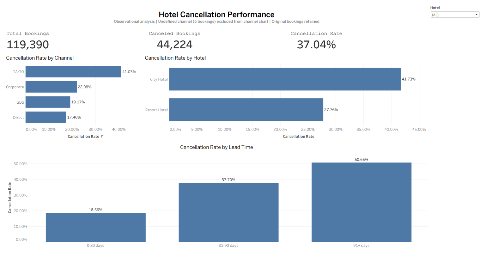
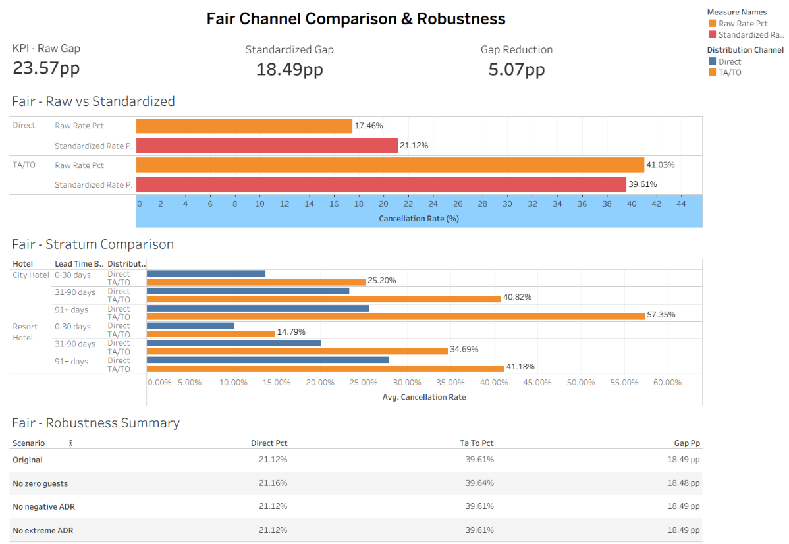

# StaySure FairCompare

**Hotel Booking Cancellation Analysis & Fair Distribution-Channel Comparison**

A portfolio case study built with **Excel / Power Query, PostgreSQL, Python and Tableau** to investigate hotel booking cancellations—and a question that a simple dashboard cannot answer on its own:

> **Does the cancellation-rate gap between Direct and travel-agent / tour-operator bookings remain when both channels are compared using the same mix of hotel types and booking lead times?**

[**View the Tableau dashboards**](https://public.tableau.com/app/profile/suraj.suraj1627/viz/StaySure_FairCompare/Dashboard1) · [**Explore the methodology**](docs/methodology.md) · [**Read the findings**](docs/key_findings.md) · [**MIT License**](LICENSE)

**Tech stack:** Excel · Power Query · PostgreSQL · SQL · Python · pandas · Matplotlib · Tableau Public

---

## At a glance

| Dataset / analysis metric | Verified result |
|:---|---:|
| Booking records analyzed | **119,390** |
| Canceled bookings | **44,224** |
| Overall cancellation rate | **37.04%** |
| Direct channel — raw cancellation rate | **17.46%** |
| TA/TO channel — raw cancellation rate | **41.03%** |
| Raw channel gap (TA/TO − Direct) | **23.57 percentage points** |
| Gap after hotel × lead-time standardization | **18.49 percentage points** |
| Reduction in the observed gap | **5.07 percentage points** |

**Main finding:** Direct has a lower observed cancellation rate than TA/TO. Adjusting both channels to a **common hotel-type × lead-time distribution** reduces the observed gap from **23.57 pp** to **18.49 pp**. The difference in booking mix accounts for part of the unadjusted comparison, but this **does not establish a causal effect of distribution channel**.

The fair comparison covers **112,515 Direct and TA/TO bookings**, grouped into **six common strata** (2 hotel types × 3 lead-time buckets).

## Dashboards

### 1. Hotel Cancellation Performance

Overall booking KPIs, cancellation rates across distribution channels, hotel types and booking lead-time buckets.

[](https://public.tableau.com/app/profile/suraj.suraj1627/viz/StaySure_FairCompare/Dashboard1)

### 2. Fair Channel Comparison & Robustness

Raw versus standardized rates, a stratum-level Direct vs TA/TO comparison, and sensitivity checks for flagged records.



**[Open the published Tableau workbook](https://public.tableau.com/app/profile/suraj.suraj1627/viz/StaySure_FairCompare/Dashboard1)** to navigate between dashboards. The packaged workbook is also available at [`tableau/StaySure_FairCompare.twbx`](tableau/StaySure_FairCompare.twbx).

## Business questions

1. How common are cancellations overall and across hotel types, channels and booking lead times?
2. How different are Direct and TA/TO cancellation rates **before** adjustment?
3. How much of that gap remains if both channels are evaluated under a **shared hotel × lead-time composition**?
4. Do the standardized rates change materially when zero-guest or anomalous ADR records are excluded?
5. What data-quality limitations prevent stronger conclusions?

## Approach

| Stage | What I did | Project files |
|:---|:---|:---|
| **1. Inspect & prepare** | Profiled the original booking data and worked through cleaning in Excel / Power Query. | [Excel workbook](excel/StaySure_FairCompare.xlsx) |
| **2. Validate with SQL** | Created a raw-data schema, checked quality, constructed typed analysis data and calculated cancellation KPIs. | [SQL scripts](sql/) |
| **3. Independently analyze in Python** | Validated counts, explored patterns, calculated pooled weights and exported data for visualization. | [Jupyter notebook](notebooks/01_data_validation_eda.ipynb) |
| **4. Communicate findings** | Built two Tableau dashboards for operational KPIs and the standardized channel comparison. | [Tableau workbook](tableau/StaySure_FairCompare.twbx) |

**Data policy:** I retained the original **119,390** booking rows in the main analysis. Records with identical values across all available columns were **not automatically deleted** because the dataset has no unique booking identifier. See [data quality and limitations](docs/limitations.md).

## What makes the channel comparison fairer?

A raw comparison mixes together bookings made under different conditions. City and Resort hotels, for example, may have different cancellation behavior, as may bookings made 10 versus 150 days in advance.

I grouped Direct and TA/TO bookings by:

- **Hotel:** City Hotel or Resort Hotel
- **Lead time:** 0–30, 31–90 or 91+ days

For each of the **six** hotel × lead-time groups, I calculated a shared weight based on its proportion of *all Direct + TA/TO bookings*. I then applied the **same weights** to each channel's within-group cancellation rates.

```text
Shared weight in stratum = (Direct bookings + TA/TO bookings in stratum)
                           / (All Direct + TA/TO bookings)

Standardized rate (channel) = Σ [shared stratum weight × channel's stratum rate]

Standardized gap = Standardized TA/TO rate − Standardized Direct rate
```

| Comparison | Direct | TA/TO | Difference (TA/TO − Direct) |
|:---|---:|---:|---:|
| Raw cancellation rate | 17.46% | 41.03% | **23.57 pp** |
| Standardized cancellation rate | 21.12% | 39.61% | **18.49 pp** |

The **5.07 pp** gap reduction is calculated from *unrounded* values; subtracting the displayed rounded gaps can produce a 0.01 pp discrepancy. The analysis adjusts **only** for hotel type and lead-time bucket—not other potential confounders.

**Implementation:** [PostgreSQL calculation](sql/05_fair_comparison.sql) · [Python notebook](notebooks/01_data_validation_eda.ipynb) · [Full mathematical explanation](docs/methodology.md)

## Sensitivity checks

Each scenario excludes **one flagged record category at a time**, with pooled weights recalculated for that scenario.

| Scenario | Rows excluded (all channels) | Rows excluded (Direct + TA/TO) | Standardized Direct | Standardized TA/TO | Gap |
|:---|---:|---:|---:|---:|---:|
| Original data | 0 | 0 | 21.12% | 39.61% | **18.49 pp** |
| Exclude zero-guest bookings | 180 | 154 | 21.16% | 39.64% | **18.48 pp** |
| Exclude negative ADR record | 1 | 1 | 21.12% | 39.61% | **18.49 pp** |
| Exclude extreme ADR record | 1 | 1 | 21.12% | 39.61% | **18.49 pp** |

The zero-guest filter removes **180 rows overall**, including **154** from the Direct + TA/TO population (112,515 → 112,361). Each ADR exclusion removes only **one** Direct/TA/TO booking (112,515 → 112,514). Because so few comparison rows are removed, these sensitivity checks change the estimated gap very little. **They do not establish robustness to all data-quality issues or unmeasured confounding.** Counts are included in [`sensitivity_summary.csv`](data/processed/sensitivity_summary.csv).

An additional, **separate** hypothetical one-row-per-identical-pattern exercise was performed for the *overall cancellation rate only*. It was **not** used as a standardized channel-gap sensitivity test. [Details](docs/limitations.md).

## Repository layout

```text
StaySure-FairCompare/
├── data/
│   ├── raw/hotels.csv
│   └── processed/
│       ├── hotel_bookings_analysis.csv
│       ├── fair_channel_groups.csv
│       ├── channel_comparison.csv
│       └── sensitivity_summary.csv
├── excel/StaySure_FairCompare.xlsx
├── notebooks/01_data_validation_eda.ipynb
├── sql/
│   ├── 01_setup.sql
│   ├── 02_data_quality.sql
│   ├── 03_cleaning.sql
│   ├── 04_kpi_analysis.sql
│   ├── 05_fair_comparison.sql
│   └── 06_sensitivity.sql
├── tableau/
│   ├── StaySure_FairCompare.twbx
│   └── screenshots/
│       ├── dashboard_01.png
│       └── dashboard_02.png
├── docs/
│   ├── methodology.md
│   ├── data_dictionary.md
│   ├── key_findings.md
│   └── limitations.md
├── .gitignore
├── LICENSE
└── README.md
```

## Run the analysis locally

### Requirements

- Python with `pandas`, `matplotlib` and Jupyter Notebook
- PostgreSQL (for the SQL portion)
- Tableau Desktop / Tableau Public (to edit the workbook)
- Excel with Power Query (to inspect the Excel workflow)

### 1. Clone and open the Python notebook

```bash
git clone https://github.com/surajyadav011/StaySure-FairCompare.git
cd StaySure-FairCompare
python -m pip install pandas matplotlib notebook
jupyter notebook
```

Open `notebooks/01_data_validation_eda.ipynb` and run the cells in sequence.

> **Portable file paths:** The committed notebook now uses Python's `pathlib` instead of hardcoded Windows paths. Start Jupyter from the cloned repository root (as shown above) or from its `notebooks/` directory. It automatically resolves the source CSV and `data/processed/` output directory relative to that location. Choose an available Python kernel with the listed dependencies installed. The notebook's historical saved outputs were produced before this path update; run all cells yourself to validate your local environment.

### 2. Reproduce the SQL analysis

1. Create an empty PostgreSQL database and connect to it.
2. Run [`sql/01_setup.sql`](sql/01_setup.sql) to create the `raw` schema and `raw.hotel_bookings` table.
3. **Import the 32-column `data/raw/hotels.csv` file** into `raw.hotel_bookings`. For example, in the `psql` CLI (replace the path):

   ```sql
   \copy raw.hotel_bookings FROM '/absolute/path/to/StaySure-FairCompare/data/raw/hotels.csv' WITH (FORMAT csv, HEADER true, NULL '')
   ```

4. Run the remaining scripts in numerical order: [02 — Data Quality](sql/02_data_quality.sql), [03 — Cleaning](sql/03_cleaning.sql), [04 — KPIs](sql/04_kpi_analysis.sql), [05 — Fair Comparison](sql/05_fair_comparison.sql), [06 — Sensitivity](sql/06_sensitivity.sql).
5. Compare results with [verified findings](docs/key_findings.md) and the Python output.

**Notes:** The CSV import is **manual**; it is not performed by the SQL scripts. The `\copy` command works in `psql`, not as a regular SQL statement in pgAdmin's Query Tool.

**SQL rerun behavior:**
- `01_setup.sql` uses `CREATE SCHEMA IF NOT EXISTS` and `CREATE TABLE IF NOT EXISTS`, so repeated execution does not recreate or empty the raw table.
- `02_data_quality.sql`, `04_kpi_analysis.sql`, `05_fair_comparison.sql` and `06_sensitivity.sql` contain read-only queries and can be rerun without changing tables.
- `03_cleaning.sql` **is not idempotent**: `CREATE TABLE clean.hotel_bookings AS` fails if that table already exists. Use a fresh database or intentionally reset the cleaned table and its dependent view before rerunning; do not blindly drop tables with `CASCADE` in a database containing other work.
- **Never repeat the CSV import without clearing/refreshing the raw table first**: it would append the source rows again and corrupt totals.

### 3. Review the Tableau dashboards

Open [`tableau/StaySure_FairCompare.twbx`](tableau/StaySure_FairCompare.twbx) or use the [published Tableau workbook](https://public.tableau.com/app/profile/suraj.suraj1627/viz/StaySure_FairCompare/Dashboard1). The processed CSVs represent different data grains; **do not join row-level and aggregated exports without checking their grain**.

## Documentation

| Document | What it covers |
|:---|:---|
| [Methodology](docs/methodology.md) | Standardization formula, common weights, population and units |
| [Data dictionary](docs/data_dictionary.md) | Original booking fields and derived Tableau export fields |
| [Key findings](docs/key_findings.md) | Hotel/channel/lead-time results and sensitivity tables |
| [Limitations](docs/limitations.md) | Missing data, identical-row patterns, assumptions and non-causal interpretation |

## Dataset attribution

The hotel bookings data comes from the public [**TidyTuesday dataset published on 2020-02-11**](https://github.com/rfordatascience/tidytuesday/tree/main/data/2020/2020-02-11), based on the *Hotel Booking Demand* dataset described by Nuno António, Ana de Almeida and Luís Nunes (2019).

This is a **historical observational dataset**—not live hotel business data. Dataset provenance and any applicable third-party rights remain with their original sources.

## Author

**Suraj** · [GitHub: @surajyadav011](https://github.com/surajyadav011) · [Tableau Public portfolio](https://public.tableau.com/app/profile/suraj.suraj1627)

I built this project to go beyond descriptive KPIs: to validate the underlying data, question raw comparisons, and communicate what the numbers **can—and cannot—support**.

## License

The **original project code and documentation** are made available under the [**MIT License**](LICENSE). Copyright © 2026 Suraj.

**Third-party datasets, libraries and other external materials are not relicensed by this repository's MIT License.** Consult the original sources and their terms before reusing those materials.
